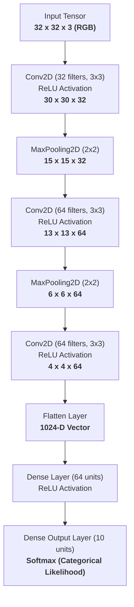
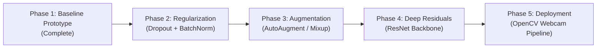

<div align="center">

# 🧠 Deep Vision: Multi-Class Image Classification with CNNs

**An End-to-End Convolutional Neural Network Framework for High-Accuracy Visual Categorization on CIFAR-10**

[](https://www.python.org/)
[](https://www.tensorflow.org/)
[](https://opencv.org/)
[](https://numpy.org/)
[](LICENSE)
[]()

<p align="center">
  <a href="#-project-overview">Project Overview</a> •
  <a href="#-dataset-benchmark">Dataset Benchmark</a> •
  <a href="#-cnn-architectural-design">Architecture</a> •
  <a href="#-training--optimization-paradigm">Optimization</a> •
  <a href="#-current-empirical-results">Results</a> •
  <a href="#-development-roadmap">Roadmap</a> •
  <a href="#-installation--usage">Getting Started</a>
</p>

</div>

---

## 📌 Project Overview

This repository hosts a research and engineering pipeline for building, training, and benchmarking high-performance **Convolutional Neural Networks (CNNs)** for multi-class image classification. 

Addressing the visual recognition challenge over natural imagery, the model maps low-resolution $32 \times 32 \times 3$ RGB tensors across 10 mutually exclusive semantic classes from the canonical **CIFAR-10** benchmark.

### Core Objectives
- **Representation Learning**: Implement deep convolutional feature extractors that capture hierarchical spatial representations from low-level edges to contextual visual motifs.
- **Empirical Optimization**: Mitigate optimization instability and evaluate loss surface geometry via continuous feature normalization and adaptive gradient methods.
- **Generalization Control**: Quantify the generalization gap ($\hat{\mathcal{R}}_{\text{val}} - \hat{\mathcal{R}}_{\text{train}}$) and apply regularization techniques (Dropout, Batch Normalization, and Data Augmentation) to counter overfitting.
- **Production-Ready Inference**: Bridge deep learning models with OpenCV for real-time inference and prediction on arbitrary test imagery.

---

## 📊 Dataset Benchmark: CIFAR-10

The project utilizes the **CIFAR-10** (Canadian Institute for Advanced Research) dataset, a widely recognized computer vision benchmark curated by Alex Krizhevsky.

| Property | Value |
| :--- | :--- |
| **Total Images** | 60,000 |
| **Spatial Dimensions** | $32 \times 32$ pixels |
| **Color Channels** | 3 (RGB) |
| **Number of Classes** | 10 mutually exclusive categories |
| **Class Distribution** | Uniform (6,000 images per class) |
| **Baseline Split** | 50,000 Train / 10,000 Test |

### Semantic Class Ontology
```
  [0] Airplane    ✈️     [1] Automobile  🚗     [2] Bird        🐦     [3] Cat         🐱     [4] Deer        🦌
  [5] Dog         🐶     [6] Frog        🐸     [7] Horse       🐴     [8] Ship        🚢     [9] Truck       🚚
```

---

## 🏗️ CNN Architectural Design

### Inductive Biases
Unlike fully-connected Multi-Layer Perceptrons (MLPs), which flatten spatial dimensions and introduce parameter explosion, CNNs exploit two foundational visual priors:
1. **Local Connectivity (Receptive Fields)**: Exploits spatial locality; adjacent pixels share significantly higher mutual information than distant ones.
2. **Translation Equivariance via Weight Sharing**: Applying identical filter kernels across the spatial grid guarantees that shifted features yield shifted activations:
   $$f(T_g(\mathbf{x})) = T_g(f(\mathbf{x}))$$

### Network Topology Diagram



### Layer-by-Layer Detailed Specification

| Stage | Layer Type | Kernel / Size | Stride | Activation | Output Shape | Parameters | Functional Role |
| :--- | :--- | :---: | :---: | :---: | :---: | :---: | :--- |
| **Input** | InputLayer | — | — | — | `(32, 32, 3)` | 0 | Raw normalized pixel values $[0.0, 1.0]$ |
| **Feature 1** | Conv2D | $3 \times 3$ | 1 | ReLU | `(30, 30, 32)` | 896 | Edge, texture, and chromatic gradient detectors |
| **Pooling 1** | MaxPooling2D | $2 \times 2$ | 2 | — | `(15, 15, 32)` | 0 | Spatial downsampling & receptive field expansion |
| **Feature 2** | Conv2D | $3 \times 3$ | 1 | ReLU | `(13, 13, 64)` | 18,496 | Mid-level part primitives & local motif synthesis |
| **Pooling 2** | MaxPooling2D | $2 \times 2$ | 2 | — | `(6, 6, 64)` | 0 | Invariance to localized translations |
| **Feature 3** | Conv2D | $3 \times 3$ | 1 | ReLU | `(4, 4, 64)` | 36,928 | High-level contextual semantic representation |
| **Neck** | Flatten | — | — | — | `(1024)` | 0 | Serializes spatial maps into 1D latent feature vector |
| **Latent** | Dense | — | — | ReLU | `(64)` | 65,600 | Non-linear dense feature projection & mixing |
| **Classifier**| Dense | — | — | Softmax | `(10)` | 650 | Posterior class distribution over 10 categories |

---

## ⚙️ Training & Optimization Paradigm

### 1. Feature Preprocessing & Conditioning
Input pixel matrices are scaled from discrete integer ranges $[0, 255]$ into continuous unit intervals:
$$\mathbf{x}_{\text{norm}} = \frac{\mathbf{x}}{255.0} \in [0.0, 1.0]$$
- **Hessian Conditioning**: Normalization reduces the spectral condition number of the empirical Hessian $\mathbf{H} = \nabla^2 \mathcal{L}(\theta)$, mitigating pathological curvature in the loss landscape.
- **Stable Gradient Flow**: Confining activation inputs prevents premature saturation of non-linearities and ensures well-behaved variance propagation.

### 2. Loss Function Formulation
The model minimizes **Sparse Categorical Cross-Entropy**, which represents the empirical negative log-likelihood over multinomial target distributions:
$$\mathcal{L}_{\text{CE}}(\theta) = -\frac{1}{B} \sum_{i=1}^{B} \log p_\theta(y_i \mid \mathbf{x}_i)$$
where $B$ is batch size, $y_i$ is the ground truth index, and $p_\theta(y_i \mid \mathbf{x}_i) = \frac{\exp(z_{y_i})}{\sum_{j=1}^{10} \exp(z_j)}$ is the softmax probability.

### 3. Optimization Algorithm
We utilize the **Adam (Adaptive Moment Estimation)** optimizer with decoupled momentum:
- First-moment vector (exponentially decaying average of past gradients):
  $$m_t = \beta_1 m_{t-1} + (1 - \beta_1) g_t$$
- Second-moment vector (uncentered variance of past squared gradients):
  $$v_t = \beta_2 v_{t-1} + (1 - \beta_2) g_t^2$$
- Coordinate-wise parameter update:
  $$\theta_{t+1} = \theta_t - \frac{\eta}{\sqrt{\hat{v}_t} + \epsilon} \hat{m}_t$$

---

## 📈 Current Empirical Results

### Baseline Prototype Performance (10 Epochs, Subsampled $N=20,000$)

| Metric | Training Set | Validation / Test Set |
| :--- | :---: | :---: |
| **Accuracy** | **~75.2%** | **~64.0%** |
| **Loss** | **0.7118** | **1.0843** |
| **Generalization Gap** | — | **+11.2% (Overfitting)** |

> [!NOTE]
> **Diagnostic Analysis**:
> The baseline model demonstrates rapid convergence on training samples, outperforming random chance ($10\%$) within Epoch 1. However, the plateau in test accuracy ($\sim 64\%$) alongside diverging test loss illustrates variance error (overfitting) stemming from unaugmented training and absence of stochastic regularization.

---

## 🚀 Development Roadmap



- [x] **Phase 1: Baseline Architecture**
  - [x] Data ingestion pipeline for CIFAR-10.
  - [x] Min-max normalization and input scaling.
  - [x] 3-stage Conv-Pool sequential backbone.
  - [x] Training loop with convergence visualization.
- [ ] **Phase 2: Stochastic Regularization & Normalization**
  - [ ] Add `BatchNormalization` after each convolution before non-linearities.
  - [ ] Introduce `SpatialDropout2D` and `Dropout(0.3 - 0.5)` in dense projection layers.
  - [ ] Implement $L_2$ weight regularization (Weight Decay).
- [ ] **Phase 3: Data Augmentation Pipeline**
  - [ ] Random affine transformations (horizontal flips, random crops, rotations).
  - [ ] Advanced augmentation: CutMix and Mixup regularization.
- [ ] **Phase 4: Architectural Scaling**
  - [ ] Implement Residual connections (Skip Connections / ResNet blocks) to eliminate vanishing gradients in deeper backbones.
  - [ ] Dynamic Learning Rate Schedules (Cosine Annealing with Warm Restarts).
- [ ] **Phase 5: Real-World Inference Engine**
  - [ ] Serialization of optimal checkpoint weights (`.keras` / `.onnx`).
  - [ ] Real-time OpenCV image classification script for external files and live webcam feed.

---

## 💻 Installation & Usage

### 1. Clone the Repository
```bash
git clone https://github.com/your-username/cifar10-cnn-classifier.git
cd cifar10-cnn-classifier
```

### 2. Environment Setup
Create and activate an isolated virtual environment:
```bash
# Windows
python -m venv .venv
.venv\Scripts\activate

# macOS / Linux
python3 -m venv .venv
source .venv/bin/activate
```

### 3. Install Dependencies
```bash
pip install tensorflow opencv-python matplotlib numpy
```

### 4. Run the Classification Notebook
Launch Jupyter to explore the notebook and inspect the PhD-level walkthrough:
```bash
jupyter notebook multi_class_image_classification.ipynb
```

---

## 📂 Project Directory Structure

```plaintext
├── multi_class_image_classification.ipynb   # Main Jupyter notebook containing CNN pipeline & evaluation
├── README.md                                # Comprehensive project documentation & architecture guide
└── .venv/                                   # Local virtual environment
```

---

## 📚 References & Literature

1. **Alex Krizhevsky (2009)**: *Learning Multiple Layers of Features from Tiny Images*. University of Toronto technical report.
2. **Yann LeCun et al. (1998)**: *Gradient-based learning applied to document recognition*. Proceedings of the IEEE.
3. **Diederik P. Kingma & Jimmy Ba (2014)**: *Adam: A Method for Stochastic Optimization*. International Conference on Learning Representations (ICLR).
4. **Kaiming He et al. (2016)**: *Deep Residual Learning for Image Recognition*. IEEE Conference on Computer Vision and Pattern Recognition (CVPR).

---

<div align="center">
  <sub>Developed for Computer Vision & Deep Learning Research. Licensed under the MIT License.</sub>
</div>

